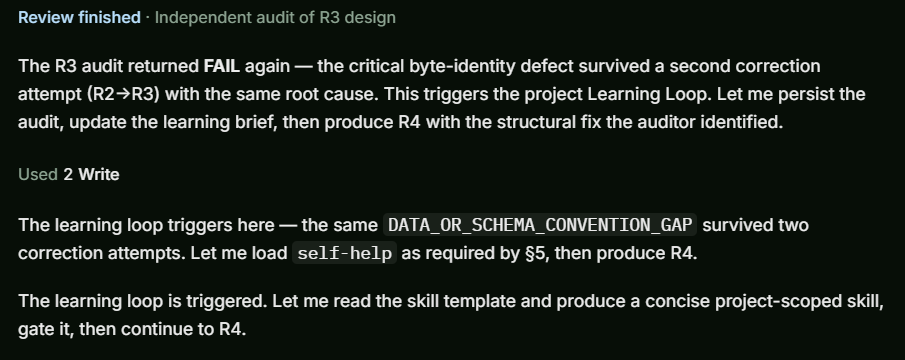

# OpenCode Skills & Agent Framework

A version-controlled global configuration for [OpenCode](https://opencode.ai) — the AI coding agent — plus a copy/paste project scaffold. It turns long autonomous coding runs on **small locally hosted models** into a disciplined, auditable process.

> *Because even AI coding agents need a little emotional and technical growth.*

---

## What this is

This repo is an OpenCode setup aimed at improving agentic code generation:

- **`AGENTS.md`** — the global base document. Every project loads it. It contains the engineering standards: workflow, verification, principles, behaviour rules, the skill hierarchy, testing protocol, documentation style (ASD-STE100-inspired).
- **`skills/`** — on-demand skills.
- **`agents/` + `commands/`** — specialist agents (`autopilot`, `rigour`, `coder`, `research`, `review`, `test`, `architect`) and slash commands.
- **`templates/AGENTS_TEMPLATES/`** — a copy/paste project scaffold. Customize only its header and `MISSION.md`; everything else stays aligned with the global config.
- **`templates/subagent-calls/`** — completion templates for invoking the specialist agents deterministically.

It is designed to be **dropped into** `~/.config/opencode/` and the contents of **`templates/AGENTS_TEMPLATES`** copied into the project root, per project. You must create your own `opencode.json` there (it is gitignored; declare your provider and a `model` that supports tool calls) — without it, nothing runs.

## Who this is for, and what it is aimed at

**Audience:** operators running OpenCode for sustained, long-horizon agentic coding — especially beneficial on **small, self-hosted models** at modest contexts (e.g. via Ollama or LM Studio; the declared `model` must support tool calls), and equally usable with frontier models to produce high quality generated code and projects.

**The aim:** make a small local model behave like a frontier one *procedurally*. Small models do not reliably generate the constraints, verification, and recovery discipline an autonomous coding run needs. This repo supplies that discipline externally:

- **File-first state** — the agent reads `TASKS.md` index + `tasks/<id>.md` detail files and memory files, never a fat prompt.
- **Delegation with verification** — every non-trivial step goes to a specialist (`research` for investigation, `coder` for implementation, `review` for adversarial checks, `test` for execution), and the primary agent verifies their outputs.
- **Quality gates before "done"** — adversarial review (checklist, security, complexity), executed tests, a final quality-gate pass, then the tick.
- **Failure recovery** - root-cause first, bounded recursion, no blind retries, blockers recorded, never silently skipped.

The result, at the cost of per-step subagent latency: long runs stay on-goal, every step's evidence is inspectable, and behaviour is consistent regardless of the executing model.

This is a **starter + personal configuration**, not a finished product. See "Honest status".

## Two operating modes

### Autopilot (default) — Light loop

The `autopilot` agent uses a slimmed-down loop. It is the quickest way to create or resume a `TASKS.md` list and to make routine changes:

- Bootstrap → light repository discovery → direct implementation or single coder call → optional targeted review/test if needed → acceptance.
- The model handles routine work internally; forcing the full pipeline on every change wastes tokens and time.
- External specialist agents are invoked only when escalation criteria are met (ambiguity, high-risk changes, or operator request).

Use when: You want fast iteration, or you want to create the task list before a high-integrity run with `@rigour`.

### @rigour — High-integrity task completion

`@rigour` is the full-pipeline entry point for work that must be finished correctly, with tests, without manual debugging. It is designed for small local models and high-stakes changes.

**Intended workflow**
1. Create or resume `TASKS.md` with the `autopilot` agent (Mode A resume, or Mode B new milestone).
2. Invoke `@rigour` — for example, "do the tasks with @rigour".
3. `@rigour` works each unchecked task through research → decomposition → adversarial review → planning → implementation → review → test → sign-off.
4. A task is ticked only after independent review, executed tests, the quality gate, and recorded evidence in `tasks/<id>.md`.

**What it enforces**
- **Research first:** no implementation without documented findings.
- **Independent review:** `review` checks the actual diff and is read-only; the author never self-approves.
- **Executed tests:** `test` runs static analysis, build, targeted, regression, integration, security, and the broader suite; PASS/FAIL evidence is captured.
- **Failure budget:** root-cause first, bounded retries, `BLOCKED` instead of silent failure. A `LEARNING_BRIEF` is emitted when a knowledge gap survives two corrections.
- **Delegation:** `@rigour` invokes `research`, `coder`, `review`, and `test`. This is granted by its `subagent` permissions; specialists do not delegate further.
- **Single path:** `@rigour` is the only rigour entry point. There is no `/rigour` slash command.
- **Shared state:** `TASKS.md`, `tasks/`, and `memory/CURRENT_STATE.md` are shared with autopilot.

**Use when:** a small local model must complete a task list with verified, tested code; the work is production or security-sensitive; or the operator wants maximum integrity and evidence.

**Configuration:** `@rigour` must be allowed to launch the specialist subagents. In OpenCode V2 this is controlled by the agent's `permissions` frontmatter (`action: subagent, allow`). The `rigour` agent declares these permissions; if they are removed, the pipeline is not enforceable.

Set `"experimental.subagent_depth": 2` in `opencode.json` to allow an orchestrating subagent to launch specialists at a deeper level. Specialists must not delegate further.

**Model capability:** `@rigour` is designed for local models where token usage is not a constraint. However, the orchestrator must be capable of following a multi-stage protocol and delegating to specialists. Models below 7B (e.g., 4B) may not reliably follow the pipeline and can hallucinate success. Use at least a 7B model for the orchestrator, or a frontier/cloud model when available. Individual specialists inherit the same model unless overridden via `model:` frontmatter.

### Model Routing

`opencode.json` declares an endpoint via `provider` plus a single `model`; **all agents inherit that one configured `model`**. There is no required cloud endpoint and no cloud/local split. The orchestrator runs specialists **sequentially** against the one endpoint — deliberate: no inference-session contention on bandwidth-limited hardware, and the workflow does not depend on any external model. The one persistent global override is an agent's own `model: <provider>/<model>[#variant]`
frontmatter; there is no `execution_model` key. Per-project routing lives in
§3.7 of the project's `AGENTS.md`: one line per agent (`coder: <provider>/<model>`).
The planner passes that `model:` on the `subagent` tool call. Unlisted agents
inherit the session model. Operators edit that section, not the global config.
Verify tool support first — a model without `tool_use` cannot run a subagent even
when `tool_call: true` is declared. `opencode.json` is local-only (gitignored). Whatever you declare is what runs — the framework is deliberately agnostic to model choice, size, and vendor, as long as the declared `model` supports tool calls.

## Autopilot in action — a real design run

These lines come from a live autopilot session on a long-running design task. The planner writes each revision to a design document, commits it, then asks an independent `review` subagent to audit it.

An operator starts with a rough idea and prompts OpenCode. OpenCode reads the current codebase and gives initial feedback. The operator refines the brief and asks `rigour` to design the architecture and implementation around the real source. Rigour writes a revision. An independent review subagent then audits that revision against the code, not against the proposal. Each audit in this run returned FAIL with a source-cited defect. The planner saved the audit, classified the defect, corrected the design, and wrote the next revision. The loop ran from R2 through R8, and had reached R9 when this was written.

```mermaid
flowchart TD
    A["Operator has an idea and prompts OpenCode with the goal"] --> B["OpenCode reads the existing codebase and gives initial feedback about live paths and safety claims"]
    B --> C["Operator refines the brief and launches rigour to design the architecture against the real code"]
    C --> R2["R2: shadow legs marked status active plus a new serving_state field"]
    R2 --> V2["Independent review FAIL: no live code reads serving_state, so all 13 call sites can serve the regression leg and byte identity fails"]
    V2 --> R3["R3: makes a dedicated regression namespace mandatory"]
    R3 --> V3["Independent review FAIL: byte identity holds in two functions only; scheduler, whitelist and tracker filter on status, role, pair and timeframe"]
    V3 --> R4["R4: adds namespace isolation and corrects the return sign convention"]
    R4 --> V4["Independent review FAIL: the sign rule contradicts itself for shorts and the portfolio-sort claim is refuted"]
    V4 --> R5["R5: resolves the sign convention and the earlier namespace findings"]
    R5 --> V5["Independent review FAIL: confidence at prediction.py:1508 is always 100, so the conformal fixture and worked example are unreachable"]
    V5 --> R6["R6: patches confidence at the secondary re-evaluation path :1508"]
    R6 --> V6["Independent review FAIL: wrong function, because the main path generate_prediction:2348 still publishes confidence 100"]
    V6 --> R7["R7: introduces a shared confidence helper at both sites plus five related fixes"]
    R7 --> V7["Independent review FAIL: three later writers overwrite confidence and the guard references an undefined leg inside a bare except"]
    V7 --> R8["R8: moves to one late override seam after all writers"]
    R8 --> V8["Independent review FAIL: model_mode is undefined, :2788 is an else keyword, and three more names do not exist"]
    V8 --> R9["R9: next revision and audit, still in progress"]
    V8 -.->|Same root cause twice| LL["Learning Loop: planner classifies the knowledge gap and loads self-help"]
    LL -.-> R9
```



The diagram shows the point of the framework. The operator gives direction once. OpenCode then carries the design forward on its own. It does not accept its own proposal. Every revision faces an independent audit with file and line evidence. A failed audit becomes a specific correction, not a restart.

> The auditor confirmed the finding: RF-7 patched the wrong function — `:1508` is the secondary re-eval path, while the main path is `generate_prediction:2348`. I'll persist the audit and produce R7 with RF-7b and the five related fixes.

> R7 is committed (`fa0f3b8`). Now the audit.

> R7 is committed and its audit is running. While it works, let me do the comprehensive confidence-writer sweep the auditor will do — checking every confidence assignment in `prediction.py` for any regression context I might have missed.

> The R7 audit found three blocking defects. The core issue: confidence is overwritten at **four** sites after `:2348` [...] This is an implementation defect, no learning brief needed. Let me persist the audit and produce R8.

> R8 is committed (`8ffc468`). Now the audit — I'll ask it to specifically validate the single-late-override point at `:2788`, since that's the crux of the fix.

> Confirmed: `model_mode` is **not** in scope in `generate_prediction` — R8's override condition uses it, which would raise `NameError`. Also, `:2788` sits inside the HTF block's `else` branch, not at a clean point after all writers.

The run shows four framework behaviours:

- The planner saves each audit before it writes the next revision.
- An independent subagent audits the design. The planner does not approve its own work.
- The planner runs non-overlapping checks while the auditor works.
- The planner classifies each failure. An implementation defect stays local. A knowledge gap triggers §5.

## Learning Loop in action

An independent audit can fail twice on the same defect. The agent then classifies the knowledge gap itself. It loads `self-help` and drafts a project-scoped skill. No operator prompt is needed.



The image shows a repeat failure on a byte-identity defect. The agent classifies it as `DATA_OR_SCHEMA_CONVENTION_GAP`, loads `self-help`, and continues to the next attempt with a structural fix.

## Quick start

**Prerequisites:** [OpenCode](https://opencode.ai) (`npm install -g opencode-ai`), Node.js, and a local OpenAI-compatible provider (Ollama / LM Studio / vLLM) whose `model` supports tool calls.

1. **Clone this repo into your global config:**

    ```bash
    git clone https://github.com/PearceTech335/open-code-skills.git ~/.config/opencode
    cd ~/.config/opencode
    ```

    *Optional: sanity-check the install with `node scripts/verify.js` (config parses; referenced files resolve). It is not required to proceed.*

2. **Scaffold a project for a long run:**

    ```bash
    cp -r ~/.config/opencode/templates/AGENTS_TEMPLATES/* ./my-project
    cd my-project && cp MISSION.md MISSION.md   # fill in the mission brief
    ```

    `MISSION.md` + `TASKS.md` (thin index; add one line per task) is all you edit by hand. Open the project in OpenCode and use the **`autopilot`** agent to create or resume the task list with a light loop. When the work must be completed with verified, tested code and no manual debugging, invoke **`@rigour`** ("do the tasks with @rigour"). `@rigour` enforces research → decomposition → adversarial review → planning → implementation → review → test → sign-off, delegating to `research`, `coder`, `review`, and `test`. Delegation is granted by `@rigour`'s `subagent` permissions in its frontmatter; do not remove them.

## How the two-layer model works

**Global base (this repo) + project complement** are both loaded in every session:

- `AGENTS.md` (this repo) — hard rules you cannot override per project: workflow, verification requirements, principles, STE-inspired documentation, Checkpoint Discipline, the QA order (`review → test → quality-gate`).
- `AGENTS.md` (your project, from the scaffold) — the task machinery: mission, `TASKS.md`/`tasks/<id>.md` workflow, failure budget, Learning Loop, Skill Policy, memory layout. Customize **only** this header and `MISSION.md`; you do not need to fork global rules into it.

## Design principles

- **No fabricated facts.** Every path and line number the agent reports must come from a tool result in that session.
- **No claim without observation.** Tests must run; stories of them mean nothing.
- **Smallest change first.** Preserve behavior and interfaces; never weaken acceptance criteria to make something pass.
- **Everything is instance state.** The framework persists state in files (`memory/`, `tasks/`), so any turn or resume works without the conversation history.
- **The reviewer is not the author.** Adversarial agents check actual diffs (never summaries); no self-approval.

## What's inside

**Core:** `agent-core` (tool discipline + always-on requirements micro-checklist + the per-task skill-loading cap), `self-help`, `auto-memory`, `template-library`, `supervisor`, `long-running-task-research`, `research-method`, `git-practices`, `readme-authoring`, `ste-writing`.

**Design, quality & process:** `readable-code`, `repo-discovery`, `project-index`, `quality-gate`, `designer`, `strategic-engineering`, `test-engineering`, `root-cause-analysis`, `interface-design`, `production-readiness`, `html-js-graphics-3d`, `network-engineer`.

**Language & domain:** `python-code`, `go-code`, `typescript-code`, `bash-skill`, `powershell-skill`, `ansible-code`, `security`, `penetration-tester`, `networking`, `ot-networking`, `packet-analysis`.

**Agents:** `autopilot` (lightweight orchestrator for capable models), `rigour` (high-integrity task completion, invoked as `@rigour`), `coder`, `research`, `review`, `test`, `architect`.

**Commands:** `/research`, `/review`, `/improve`, `/investigate`, `/overnight`.

**Static checks:** `node scripts/verify.js` (config + path references), `node scripts/validate_skills.js` (skill frontmatter/structure). No other CI exists in this repo.

## Honest status

- **Verified**: config parses; fresh project scaffold passes `verify.js --project`; all skill files pass the frontmatter validator; the framework runs a full task lifecycle in principle (designed + adversarially audited; see git history).
- **Not verified**: a live end-to-end run on a small local model is currently being executed against a real **one shot** 'Build me a game' style project. Using Qwen3-4b-Thinking-2507, when the project run has completed the whole project with and without this framework will be linked for everyone's perusal. The testing is being completed with one model, same prompt, same tasks and mission, only difference is this framework vs clean opencode. Small models remain fallible; the point of this repo is that failure is bounded, visible, traceable, reviewable and fixable, not that it never happens.
- **Not a certification**: ASD-STE100-inspired documentation style is applied as principles; this repo never claims "STE compliant" or "ASD-STE100 certified". Full conformance is an opt-in per project via the official Issue 9 standard from asd-ste100.org.
- **Personal configuration**: `opencode.json`, `plugin/`, `scripts/` are local-only (gitignored) and machine-specific.

## Safety

- WebFetch is restricted by policy to verified documentation; never to agent files, configs, or arbitrary `github.com/anomalyco/` URLs.
- No `curl | bash`. No unverified binaries. No self-approval.
- Hard blockers in autonomous runs: destructive migrations, credential changes, production deployments, security-boundary changes.
- Skills self-generated by the framework land as provisional and need human review (`auto-approve: off` by default in the starter).

---

*Fork it, adapt it, start a run. If your model survives one full `@rigour` cleanly, the experiment worked.*
